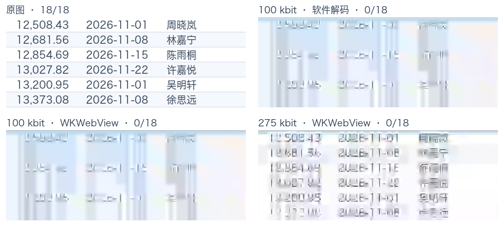

# 办公表格可读性验收

基线为 `63e9617`。在 arm64 macOS 26.7 上，经本机回环、真实 TLS 和产品 WKWebView 验收合成表格。使用 1280×720 源图、16 px 简体中文字体、24 px 行高以及金额、日期、姓名三列。采用软件 x264 模拟 720p、20 fps、750 kbps 的低档 AVC。发送端、固定证书指纹中继、Mac 本地服务及网页解码走现有链路。仅中继到 Mac 一段限速，两个方向各增加 300 ms 传播时间，发送端上传在回环直连。独立 TLS 探针的暖连接 RPC 中位数分别为 607.5 和 607.3 ms，每档 3 次。测试不连接公司电脑。

## 同帧对照

离线逐帧对齐采集、FFmpeg 软件解码、产品 Canvas 和实际 WKWebView 窗口快照。测量前六行的 384×144 px 区域，以 Vision 中英文识别逐格比对。每格包含完整金额及标点、完整日期或三个汉字，只有完全一致才计通过。保留 Unicode 兼容规范化及空白折叠，关闭语言校正。每张静止帧共 18 格。滚动时只计完整显示的行。

| 窗口大小 | 画面实际大小 | 源图到画面比例 | DPR 2 下采样区域 |
| --- | ---: | ---: | ---: |
| 1220×860 点 | 1158.02×651.38 点 | 90.47% | 695×261 px |
| 900×700 点 | 862×484.88 点 | 67.34% | 517×194 px |

两个窗口的 DPR 2 源图对照均为 **18/18**。缩小到 900×700 点并输出 1× 时，未编码源图为 13–14/18。低质量 IDR 在两组源画面和两个窗口中均为 **0/18**，软件解码及 WKWebView 同样为 0/18。首次静止画面的 RGB 平均绝对误差为软件解码 26.1/255、Canvas 25.4/255、窗口快照约 26/255。目视对照确认细笔画在软件解码阶段已经粘连或消失。候选把这张关键帧从 7506 增至 14418 字节，DPR 2 窗口误差降到约 20.4–20.5/255，识别仍为 0/18。



## 回环 TLS 验收

每轮先静止约 8 秒，然后滚动约 2 秒，停滚约 8 秒，再恢复滚动至测试结束。首屏时间从调用产品连接到 WKWebView 实际绘制。起播恢复以首张已显示画面为起点，停滚恢复以合成源停止为起点。逐张检查已绘制画面的同帧区域，并按当时 Canvas 的 CSS 尺寸和 DPR 取样。只有所有关键字段完全正确且接下来至少 5 秒保持正确，才计持续可读。OCR 在计时结束后运行。两种窗口都核对归一化坐标映射和物理几何 `0,0,1280,720`。

候选在同一画面保持 6 个采集间隔（约 300 ms）后，切到 275 kbit 缓冲并主动出一次 IDR。保持静止期间沿用该预算，主动重同步仍使用同一预算。再次移动就回到 100 kbit。起播候选还要求夹具先收到 WKWebView 的第一张 H.264 绘制事件，保证首张实际显示的 IDR 仍使用 100 kbit。这个信号只存在于试验夹具。

| 窗口点数 | Mbps | 方案 | 连接到首帧 ms | 起播最多正确 /18 | 起播首个全对 ms¹ | 停滚到首帧 ms | 停滚最多正确 /18 | 停滚首个全对 ms |
| --- | ---: | --- | ---: | ---: | ---: | ---: | ---: | ---: |
| 1220×860 | 1 | 基线 | 3521 | 0 | — | 1404 | 2 | — |
| 1220×860 | 1 | 候选 | 3538 | 3 | — | 892 | 5 | — |
| 1220×860 | 1.6 | 基线 | 3460 | 2 | — | 337 | 0 | — |
| 1220×860 | 1.6 | 候选 | 3554 | 3 | — | 425 | 5 | — |
| 900×700 | 1 | 基线 | 3525 | 2 | — | 402 | 2 | — |
| 900×700 | 1 | 候选 | 3468 | 3 | — | 937 | 5 | — |
| 900×700 | 1.6 | 基线 | 3405 | 2 | — | 335 | 0 | — |
| 900×700 | 1.6 | 候选 | 3434 | 3 | — | 431 | 5 | — |

¹ 从首张实际显示的关键帧起算。表内的「—」表示未观察到单帧全对。

四个窗口及链路组合各跑一轮基线和候选。起播首帧全部使用 100 kbit 缓冲，首帧后观察 6.21–6.49 秒。停滚后观察 8.00–8.05 秒。八轮的两个场景都未达到连续 5 秒全对。

| 窗口点数 | Mbps | 方案 | 全程帧龄 P95 ms | 再滚动首帧 ms | 再滚动帧龄 P95 ms | 再滚动帧间隔 P95 ms | 整轮下行媒体 KiB² |
| --- | ---: | --- | ---: | ---: | ---: | ---: | ---: |
| 1220×860 | 1 | 基线 | 473 | 393 | 419 | 931 | 405.2 |
| 1220×860 | 1 | 候选 | 669 | 502 | 612 | 877 | 569.9 |
| 1220×860 | 1.6 | 基线 | 563 | 978 | 462 | 1669 | 434.8 |
| 1220×860 | 1.6 | 候选 | 613 | 378 | 384 | 883 | 550.6 |
| 900×700 | 1 | 基线 | 576 | 401 | 430 | 932 | 445.1 |
| 900×700 | 1 | 候选 | 658 | 512 | 618 | 934 | 582.3 |
| 900×700 | 1.6 | 基线 | 557 | 933 | 387 | 936 | 424.3 |
| 900×700 | 1.6 | 候选 | 620 | 419 | 620 | 1692 | 556.9 |

² 中继实际写出的媒体记录字节，含 Base64 和 JSON，未计 TLS/TCP 开销与控制请求。帧龄从源端采集到 WKWebView 绘制。再滚动首帧从源画面重新移动起算。

静止阶段主动生成的高预算关键帧为 14131–14418 字节，6/8 张实际显示。首张实际显示的 275 kbit 画面在起播后 702–796 ms、停滚后 892–2277 ms 到达。在 1220×860 点、1 Mbps 下，基线与候选恢复滚动的首帧分别为 393 和 502 ms，帧龄 P95 分别为 419 和 612 ms。每个组合只有一轮，时延差值用于记录观测退化，无法独立归因。

**验收未通过。** 增大静止帧缓冲仍达不到持续完整可读的要求，候选保留在合成夹具中。改动限于验收夹具和报告。

## JPEG 局部清晰图对照

质量 75 的本地 JPEG 编码，整屏 281865–282187 字节，384×144 px 区域 15538–15824 字节，两种都为 18/18。按现有 Base64 负载计算，整屏单次串行化约 3.01 秒和 1.88 秒，局部约 166–169 ms 和 104–106 ms，分别对应 1 和 1.6 Mbps。此项只测编解码字节和识别率，时间是按限速推算，不含传输往返。实验已知这块区域的字段位置。普通连续桌面没有这项信息，也需要处理滚动时作废旧区域，因此本次没有接入局部覆盖。

## 复跑

```sh
uv run --offline --no-project --python 3.12 \
  --with-requirements tests/video_stream/requirements.txt \
  python tests/video_stream/office_readability.py --output /tmp/lanpilot-office-readability
```

输出含真实窗口快照、逐帧识别及像素误差、H.264 帧字节、TLS 媒体记录字节、源采集和接收／绘制时间戳。发送端是模拟器，Windows MFT 画质和生产网络表现未测。几何核对使用产品坐标计算，未发送键鼠。对照过程不修改采样间隔或输入调度。
